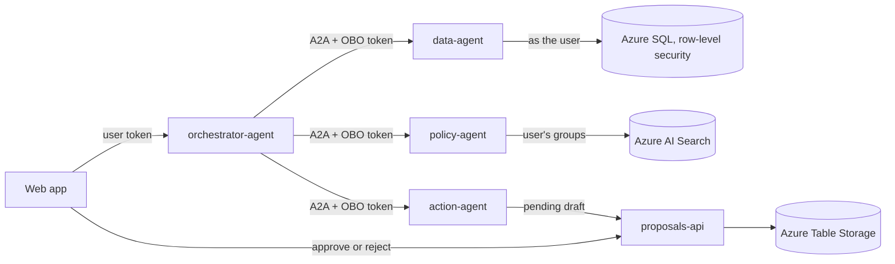

# Margin Copilot

A secure multi-agent pricing assistant on Azure, built as a personal learning project.

Pricing managers at Riad Market, a fictional Moroccan grocery chain, ask why margins moved and what pricing policy allows. An orchestrator plans each question and calls three specialist agents (data, policy, action) that answer from synthetic sales data and policy documents, show each manager only their own region, and draft price changes. A person approves them in proposals-api, a service with no model in it.

**Status:** milestone 9 done (one trace per chat turn across every service, keyless and without content; alerts by email; a Grafana dashboard; every live eval run reports time and cost per question; a measured [latency baseline](research/2026-11-latency-baseline.md)). Then the [latency fixes](research/2026-11-latency-baseline.md#after-the-fixes-2026-11-24) (D-044): the warm demo question takes about 44 s instead of 60–88 s, and about 48 s right after sign-in from a cold system instead of 168 s. Then [streaming](research/2026-11-latency-baseline.md#streaming-2026-11-24) (D-045): the chat shows each step from the first second and, on the demo question, the data agent's reply at about 19 s; the full answer takes about 36 s. Then milestone 10 (D-046): one Bicep deployment builds the whole system and keeps the live images, and a push to `main` tests a service, runs the evals gate (orchestrator, data agent), deploys it through GitHub OIDC with no stored credential, waits for a ready revision and smoke-tests it; the web app builds its CSP with the APIs' exact hosts. The live gate passed 54/54 three runs in a row. Next: milestone 11 (adversarial pass).

## Read in this order

1. [brief.md](brief.md): the original idea.
2. [roadmap.md](roadmap.md): repo layout, milestones and timeline.
3. [decisions.md](decisions.md): every decision, why it was made, and what was rejected.
4. [security-model.md](security-model.md): how identity crosses every hop and what each service checks.
5. [guides/run-it-yourself.md](guides/run-it-yourself.md): build the whole system on your own Azure account and GitHub organization.
6. [research/2026-11-docs.md](research/2026-11-docs.md): the Microsoft docs and prices behind those decisions, with sources.
7. [plans/](plans/): step-by-step implementation plans, one per milestone.

## Architecture at a glance

The three specialist agents are reachable only inside the Container Apps environment. Every hop exchanges the user's token for one addressed to the next service, so row-level security still applies three hops from the browser.

## Repos

| Repo | What it holds |
|---|---|
| [web](https://github.com/margin-copilot/web) | Chat and approval screens (React, Vite, MSAL.js) |
| [orchestrator](https://github.com/margin-copilot/orchestrator) | Orchestrator agent and chat API |
| [data-agent](https://github.com/margin-copilot/data-agent) | Read-only SQL over Azure SQL as the signed-in user |
| [policy-agent](https://github.com/margin-copilot/policy-agent) | Cited search over pricing policies |
| [action-agent](https://github.com/margin-copilot/action-agent) | Drafts price-change proposals |
| [proposals-api](https://github.com/margin-copilot/proposals-api) | Approval rules and proposal storage, no LLM |
| [shared](https://github.com/margin-copilot/shared) | Contracts and the security module |
| [data](https://github.com/margin-copilot/data) | Synthetic data generator, RLS scripts, policy documents |
| [evals](https://github.com/margin-copilot/evals) | Golden and adversarial test suites |
| docs | This repo |
| infra | Private: Bicep and non-secret configuration |

## Working on it with Claude Code

[CLAUDE.md](CLAUDE.md) holds the rules Claude Code follows in every repo: the architecture, the "never do" list, conventions and budget guardrails. Clone all repos side by side in one folder and symlink `docs/CLAUDE.md` into that folder.

## Repo baseline

[templates/](templates/) holds the files every repo shares (MIT license, secret scanning before each commit, a CI secret scan, the README) and `apply-baseline.sh`, which applies them.

## License

MIT. See [LICENSE](LICENSE).
