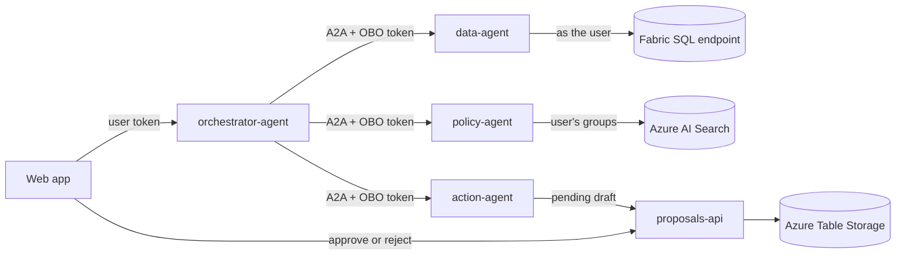

# Milestone 0: Accounts and Guardrails Implementation Plan

> **For agentic workers:** REQUIRED SUB-SKILL: Use superpowers:subagent-driven-development (recommended) or superpowers:executing-plans to implement this plan task-by-task. Steps use checkbox (`- [ ]`) syntax for tracking.

**Goal:** Local tools, eleven repos in the GitHub organization `margin-copilot` with secret scanning and green CI, a public docs hub holding the project docs, an Azure subscription with budget alerts as code, and four Entra test users in five groups.

**Architecture:** One shared repo baseline (MIT license, pre-commit gitleaks, CI gitleaks, README linking the docs hub) lives as a template in `docs/templates/` and is applied to every repo by one script. Azure budget is Bicep at subscription scope in the private infra repo; the alert email is passed at deploy time and never committed. Entra users and groups come from an idempotent shell script plus a check script that fails until they exist.

**Tech Stack:** Homebrew, GitHub CLI, Azure CLI + Bicep, uv (Python 3.12), gitleaks v8.30.1 (pre-commit hook and CI binary), GitHub Actions (`actions/checkout@v7`).

**Spec:** `roadmap.md` (milestone 0 row), `decisions.md` (D-016, D-019 to D-025), `CLAUDE.md`.

Revision 2 (2026-11-15): repos moved into the GitHub organization `margin-copilot` (D-025). Workspace `docs/` folder renamed `planning/` so the docs repo can be cloned as `docs/`.

## Global Constraints

- All repos belong to the GitHub organization `margin-copilot`, named without prefix. Public: web, orchestrator, data-agent, policy-agent, action-agent, proposals-api, shared, data, evals, docs. Private: infra. Local clones sit in `<workspace>/<name>/`.
- Every public repo carries the MIT license, copyright "Margin Copilot contributors" (D-021). The private infra repo has no license file.
- Repos are created empty; every commit, including the first, is made locally with the owner's GitHub no-reply email (`<id>+<login>@users.noreply.github.com`).
- No secrets in any repo, image or log, including the private infra repo.
- No personal or career content in any file. Public docs use placeholders, never real tenant, subscription, app or resource IDs, and never a personal email.
- Pinned versions: gitleaks `v8.30.1` (pre-commit and CI); `actions/checkout@v7`; Python 3.12; uv `0.13.6` wherever CI installs uv (not needed in this milestone).
- Azure region: `francecentral`.
- Stay on the Azure free account (hard $200 spending cap) until model quota or day 28 forces the upgrade to pay-as-you-go (D-024).
- Budget: 20 in the billing currency, alerts at 50% and 90% (about $10 and $18).
- Interactive sign-ins use the browser. Device code flow is blocked in new tenants since 2026-07-01.
- Every git push listed in this plan is covered by the owner's approval of the plan; nothing outside it gets pushed.
- Commit messages end with `Co-Authored-By: Claude Opus 5.5 <noreply@anthropic.com>`.

## Review Focus

1. **A secret slips into a commit** (an `.env` file, a pasted key): the pre-commit hook must block it before it exists in history. Task 3 plants a generated fake GitHub token and expects the commit to fail.
2. **The owner's personal email appears in public commit metadata**: every author email in every repo must be the no-reply address. Repos are created empty (no GitHub-authored commits); Task 3 checks `git log` in all eleven repos before pushing.
3. **Real IDs or emails reach the public docs repo**: tenant and subscription GUIDs, the alert email. Task 4 greps the docs repo for GUIDs and email addresses before the push; Task 6 greps the infra repo for email literals.
4. **The Entra seed script runs twice** and creates duplicates or crashes: a second run must change nothing. Task 7 runs it twice and re-runs the check.
5. **The billing currency isn't USD**: a 20 MAD budget would alert at about $1. Task 5 reads the currency; Task 6 sets the amount from it.

---

### Task 1: Local toolchain and git identity — DONE

Installed gh, Azure CLI + Bicep, uv + Python 3.12, gitleaks, pre-commit; `gh` logged in; global git identity set to the no-reply email; `init.defaultBranch main`; owner confirmed GitHub email privacy. See the ledger.

---

### Task 2: Organization and the eleven repos

**Files:**
- Create: `docs/templates/repos.txt`

**Interfaces:**
- Consumes: logged-in `gh` (Task 1); organization `margin-copilot` with the owner as admin; empty repo `margin-copilot/docs` cloned at `docs/` (done before this revision).
- Produces: eleven clones at `<workspace>/<name>/`; `docs/templates/repos.txt` with one line per repo, format `name|visibility|description`, read by Tasks 3 and 8.

- [ ] **Step 1: Write the repo list**

Create `docs/templates/repos.txt`:
```
web|public|Margin Copilot web app: chat and approval screens (React, Vite, MSAL.js)
orchestrator|public|Margin Copilot orchestrator agent: chat API that calls the specialist agents over A2A
data-agent|public|Margin Copilot data agent: read-only SQL over Fabric as the signed-in user
policy-agent|public|Margin Copilot policy agent: cited search over pricing policies in Azure AI Search
action-agent|public|Margin Copilot action agent: drafts price-change proposals for human approval
proposals-api|public|Margin Copilot proposals API: approval rules and proposal storage, no LLM
shared|public|Margin Copilot shared library: contracts and the security module used by every service
data|public|Margin Copilot data: synthetic dataset generator, RLS scripts, policy documents, indexer
evals|public|Margin Copilot evals: golden and adversarial test suites
docs|public|Margin Copilot docs: start here to learn how the whole system works
infra|private|Margin Copilot infrastructure: Bicep and non-secret configuration
```

- [ ] **Step 2: Create and clone the other ten (empty)**

```bash
cd <workspace>
while IFS='|' read -r name visibility description; do
  [ "$name" = docs ] && continue
  gh repo create "margin-copilot/$name" "--$visibility" --description "$description" --clone >/dev/null 2>&1 \
    && echo "created $visibility: $name" || echo "FAILED: $name"
done < docs/templates/repos.txt
```

- [ ] **Step 3: Verify the repos exist**

Run:
```bash
gh repo list margin-copilot --limit 50 --json name,visibility --jq '.[] | "\(.name) \(.visibility)"' | sort
cd <workspace> && while IFS='|' read -r name _ _; do [ -d "$name/.git" ] || echo "missing clone: $name"; done < docs/templates/repos.txt; echo "clones checked"
```
Expected: 11 lines, `infra PRIVATE` and the rest `PUBLIC`; no `missing clone` lines.

- [ ] **Step 4: Turn on secret scanning and push protection for the public repos**

```bash
cd <workspace>
while IFS='|' read -r name visibility _; do
  [ "$visibility" = public ] || continue
  gh repo edit "margin-copilot/$name" --enable-secret-scanning --enable-secret-scanning-push-protection
done < docs/templates/repos.txt
```

- [ ] **Step 5: Verify push protection**

Run:
```bash
cd <workspace>
while IFS='|' read -r name visibility _; do
  [ "$visibility" = public ] || continue
  printf '%-15s ' "$name"; gh api "repos/margin-copilot/$name" --jq '.security_and_analysis.secret_scanning_push_protection.status'
done < docs/templates/repos.txt
```
Expected: `enabled` for all ten public repos. (Push protection isn't available for free on a private repo; infra relies on gitleaks.)

---

### Task 3: Repo baseline: license, secret scanning, CI and READMEs

**Files:**
- Create: `docs/templates/repo-baseline/.pre-commit-config.yaml`
- Create: `docs/templates/repo-baseline/ci.yml`
- Create: `docs/templates/repo-baseline/gitignore`
- Create: `docs/templates/repo-baseline/README.md`
- Create: `docs/templates/repo-baseline/README.private.md`
- Create: `docs/templates/apply-baseline.sh`
- Modify (by the script): `LICENSE` (public repos), `.pre-commit-config.yaml`, `.github/workflows/ci.yml`, `.gitignore`, `README.md` in every repo (README skipped for docs, which gets its own in Task 4)

**Interfaces:**
- Consumes: `docs/templates/repos.txt` (Task 2), `gh`, `pre-commit` (Task 1).
- Produces: `docs/templates/apply-baseline.sh <workspace-dir>`, which re-applies the baseline to every repo and installs the pre-commit hook.

- [ ] **Step 1: Write the baseline files**

`docs/templates/repo-baseline/.pre-commit-config.yaml`:
```yaml
repos:
  - repo: https://github.com/gitleaks/gitleaks
    rev: v8.30.1
    hooks:
      - id: gitleaks
```

`docs/templates/repo-baseline/ci.yml`:
```yaml
name: ci

on:
  push:
    branches: [main]
  pull_request:

permissions:
  contents: read

jobs:
  secret-scan:
    runs-on: ubuntu-latest
    env:
      GITLEAKS_VERSION: 8.30.1
    steps:
      - uses: actions/checkout@v7
        with:
          fetch-depth: 0
      - name: Install gitleaks (checksum verified)
        run: |
          base="https://github.com/gitleaks/gitleaks/releases/download/v${GITLEAKS_VERSION}"
          tarball="gitleaks_${GITLEAKS_VERSION}_linux_x64.tar.gz"
          curl -sSfLO "$base/$tarball"
          curl -sSfLO "$base/gitleaks_${GITLEAKS_VERSION}_checksums.txt"
          sha256sum --check --ignore-missing "gitleaks_${GITLEAKS_VERSION}_checksums.txt"
          tar -xzf "$tarball" gitleaks
      - name: Scan full history
        run: ./gitleaks git --redact --verbose .
```

`docs/templates/repo-baseline/gitignore`:
```
# secrets and local config
.env
.env.*
!.env.example

# Python
.venv/
__pycache__/
*.pyc
.pytest_cache/
.ruff_cache/

# Node
node_modules/
dist/

# OS and editors
.DS_Store
.vscode/
.idea/
```

`docs/templates/repo-baseline/README.md`:
```markdown
# Margin Copilot: {{NAME}}

{{DESCRIPTION}}.

Part of **Margin Copilot**, a secure multi-agent pricing assistant on Azure, built as a personal learning project.

**Start here:** [margin-copilot/docs](https://github.com/margin-copilot/docs) explains how the whole system works and how the repos fit together.

Status: scaffold. See the [roadmap](https://github.com/margin-copilot/docs/blob/main/roadmap.md).

## License

MIT. See [LICENSE](LICENSE).
```

`docs/templates/repo-baseline/README.private.md`:
```markdown
# Margin Copilot: {{NAME}}

{{DESCRIPTION}}.

Private: infrastructure as code and non-secret configuration for **Margin Copilot**. Secrets never go here; they live in Key Vault or come from the environment at deploy time.

**How the system works:** [margin-copilot/docs](https://github.com/margin-copilot/docs).
```

- [ ] **Step 2: Write the apply script**

`docs/templates/apply-baseline.sh`:
```bash
#!/usr/bin/env bash
# Copies the shared baseline into every Margin Copilot repo and installs the pre-commit hook.
# Usage: docs/templates/apply-baseline.sh <workspace-dir>
set -euo pipefail

here="$(cd "$(dirname "$0")" && pwd)"
workspace="${1:?usage: apply-baseline.sh <workspace-dir>}"
license_body="$(gh api licenses/mit --jq .body | sed -e 's/\[year\]/2026/' -e 's/\[fullname\]/Margin Copilot contributors/')"

while IFS='|' read -r name visibility description; do
  repo="$workspace/$name"
  [ "$visibility" = public ] && printf '%s\n' "$license_body" > "$repo/LICENSE"
  cp "$here/repo-baseline/.pre-commit-config.yaml" "$repo/.pre-commit-config.yaml"
  mkdir -p "$repo/.github/workflows"
  cp "$here/repo-baseline/ci.yml" "$repo/.github/workflows/ci.yml"
  cp "$here/repo-baseline/gitignore" "$repo/.gitignore"
  if [ "$name" != docs ]; then
    template="$here/repo-baseline/README.md"
    [ "$visibility" = private ] && template="$here/repo-baseline/README.private.md"
    sed -e "s|{{NAME}}|$name|g" -e "s|{{DESCRIPTION}}|$description|g" "$template" > "$repo/README.md"
  fi
  (cd "$repo" && pre-commit install >/dev/null)
  echo "baseline applied: $name"
done < "$here/repos.txt"
```
Then: `chmod +x docs/templates/apply-baseline.sh`

- [ ] **Step 3: Apply the baseline**

Run: `<workspace>/docs/templates/apply-baseline.sh <workspace>`
Expected: 11 lines `baseline applied: <name>`; `head -3 docs/LICENSE` shows `MIT License` and `Copyright (c) 2026 Margin Copilot contributors`; `infra/LICENSE` does not exist.

- [ ] **Step 4: Prove the hook blocks a secret (expected failure)**

The fake token is generated at run time so no token-shaped string is ever written into this plan or a repo.
```bash
cd <workspace>/docs
printf 'token = ghp_%s\n' "$(LC_ALL=C tr -dc 'A-Za-z0-9' </dev/urandom | head -c 36)" > leak-test.txt
git add leak-test.txt
git commit -m "test: this commit must be blocked"
```
Expected: the commit FAILS, the gitleaks hook reports `leaks found: 1` (rule `github-pat`). The first run takes a minute while pre-commit builds gitleaks.

- [ ] **Step 5: Clean up the planted file**

```bash
git rm -q --cached leak-test.txt && rm leak-test.txt
git status --short
```
Expected: `leak-test.txt` no longer listed; no commit exists yet in this repo.

- [ ] **Step 6: Commit the baseline in every repo**

```bash
cd <workspace>
while IFS='|' read -r name _ _; do
  (cd "$name" && git add -A && git commit -q -m "chore: add repo baseline (license, secret scanning, CI, README)

Co-Authored-By: Claude Opus 5.5 <noreply@anthropic.com>" && echo "committed: $name")
done < docs/templates/repos.txt
```
Expected: 11 `committed:` lines; the gitleaks hook passes in each.

- [ ] **Step 7: Check every author email before pushing**

Run:
```bash
cd <workspace>
while IFS='|' read -r name _ _; do git -C "$name" log --format='%ae'; done < docs/templates/repos.txt | sort -u
```
Expected: exactly one address, ending in `@users.noreply.github.com`. Anything else: stop, do not push, fix with the owner.

- [ ] **Step 8: Push and check CI**

```bash
cd <workspace>
while IFS='|' read -r name _ _; do (cd "$name" && git push -q -u origin main); done < docs/templates/repos.txt
sleep 90
while IFS='|' read -r name _ _; do
  printf '%-15s ' "$name"; gh run list -R "margin-copilot/$name" --workflow ci --limit 1 --json conclusion --jq '.[0].conclusion'
done < docs/templates/repos.txt
```
Expected: `success` for all 11. If a run is still in progress, run `gh run watch -R margin-copilot/<name>` and re-check.

---

### Task 4: Docs repo content and the `CLAUDE.md` symlink

**Files:**
- Move: `planning/decisions.md` → `docs/decisions.md`
- Move: `planning/plan.md` → `docs/roadmap.md`
- Move: `planning/superpowers/plans/2026-11-15-milestone-0.md` → `docs/plans/2026-11-15-milestone-0.md`
- Move: `research/2026-11-docs.md` → `docs/research/2026-11-docs.md`
- Move: `azure_project.md` → `docs/brief.md`
- Move: `CLAUDE.md` → `docs/CLAUDE.md`, then create symlink `CLAUDE.md` → `docs/CLAUDE.md`
- Create: `docs/README.md`

**Interfaces:**
- Consumes: the docs clone with baseline (Task 3). `CLAUDE.md`, `planning/decisions.md` and `planning/plan.md` already carry the organization layout, D-019 to D-025 and the milestone 0/1 row changes.
- Produces: `CLAUDE.md` at the workspace root resolving to `docs/CLAUDE.md`; docs repo paths `decisions.md`, `roadmap.md`, `brief.md`, `research/2026-11-docs.md`, `plans/`.

- [ ] **Step 1: Move the files**

```bash
cd <workspace>
mkdir -p docs/plans docs/research
mv planning/decisions.md docs/decisions.md
mv planning/plan.md docs/roadmap.md
mv planning/superpowers/plans/2026-11-15-milestone-0.md docs/plans/
mv research/2026-11-docs.md docs/research/
mv azure_project.md docs/brief.md
mv CLAUDE.md docs/CLAUDE.md
ln -s docs/CLAUDE.md CLAUDE.md
rmdir planning/superpowers/plans planning/superpowers planning research
```

- [ ] **Step 2: Verify the symlink**

Run: `cd <workspace> && readlink CLAUDE.md && head -1 CLAUDE.md && ls`
Expected: `docs/CLAUDE.md`, then `# Margin Copilot workspace`; the workspace root lists `CLAUDE.md` and the eleven repo folders only.

- [ ] **Step 3: Fix references to the old paths**

In `docs/brief.md`, replace:
- `Current decisions live in \`docs/decisions.md\`, the plan in \`docs/plan.md\`,` → `Current decisions live in \`decisions.md\`, the plan in \`roadmap.md\`,`
- `Original architecture idea (refined in \`docs/decisions.md\`):` → `Original architecture idea (refined in \`decisions.md\`):`

In `docs/research/2026-11-docs.md`, replace:
- `## Summary: what changes vs \`azure_project.md\`` → `## Summary: what changes vs the original brief (\`brief.md\`)`

In `docs/plans/2026-11-15-milestone-0.md`, replace the Spec line:
- `**Spec:** \`planning/plan.md\` (milestone 0 row; becomes \`docs/roadmap.md\` in Task 4), \`planning/decisions.md\` (D-016, D-019 to D-025), \`CLAUDE.md\`.` → `**Spec:** \`roadmap.md\` (milestone 0 row), \`decisions.md\` (D-016, D-019 to D-025), \`CLAUDE.md\`.`

- [ ] **Step 4: Write the docs README**

Create `docs/README.md`:
````markdown
# Margin Copilot

A secure multi-agent pricing assistant on Azure, built as a personal learning project.

Pricing managers at Riad Market, a fictional Moroccan grocery chain, ask why margins moved and what pricing policy allows. Four agents answer from synthetic sales data and policy documents, show each manager only their own region, and draft price changes that a person must approve.

**Status:** milestone 0 (accounts, repos, guardrails). Nothing is deployed yet.

## Read in this order

1. [brief.md](brief.md): the original idea.
2. [roadmap.md](roadmap.md): repo layout, milestones and timeline.
3. [decisions.md](decisions.md): every decision, why it was made, and what was rejected.
4. [research/2026-11-docs.md](research/2026-11-docs.md): the Microsoft docs and prices behind those decisions, with sources.
5. [plans/](plans/): step-by-step implementation plans, one per milestone.

## Architecture at a glance



The three specialist agents are reachable only inside the Container Apps environment. Every hop exchanges the user's token for one addressed to the next service, so row-level security still applies three hops from the browser.

## Repos

| Repo | What it holds |
|---|---|
| [web](https://github.com/margin-copilot/web) | Chat and approval screens (React, Vite, MSAL.js) |
| [orchestrator](https://github.com/margin-copilot/orchestrator) | Orchestrator agent and chat API |
| [data-agent](https://github.com/margin-copilot/data-agent) | Read-only SQL over Fabric as the signed-in user |
| [policy-agent](https://github.com/margin-copilot/policy-agent) | Cited search over pricing policies |
| [action-agent](https://github.com/margin-copilot/action-agent) | Drafts price-change proposals |
| [proposals-api](https://github.com/margin-copilot/proposals-api) | Approval rules and proposal storage, no LLM |
| [shared](https://github.com/margin-copilot/shared) | Contracts and the security module |
| [data](https://github.com/margin-copilot/data) | Synthetic data generator, RLS scripts, policy documents |
| [evals](https://github.com/margin-copilot/evals) | Golden and adversarial test suites |
| docs | This repo |
| infra | Private: Bicep and non-secret configuration |

## Working on it with Claude Code

[CLAUDE.md](CLAUDE.md) holds the rules Claude Code follows in every repo: the architecture, the "never do" list, conventions and budget guardrails. Clone all repos side by side in one folder and symlink `docs/CLAUDE.md` into that folder.

## Repo baseline

[templates/](templates/) holds the files every repo shares (MIT license, secret scanning before each commit, a CI secret scan, the README) and `apply-baseline.sh`, which applies them.

## License

MIT. See [LICENSE](LICENSE).
````

- [ ] **Step 5: Scan the docs repo before the push**

Run:
```bash
cd <workspace>/docs
grep -rnIE '[0-9a-fA-F]{8}-[0-9a-fA-F]{4}-[0-9a-fA-F]{4}-[0-9a-fA-F]{4}-[0-9a-fA-F]{12}' --exclude-dir=.git . || echo "no GUIDs"
grep -rnIoE '[A-Za-z0-9._%+-]+@[A-Za-z0-9.-]+\.[A-Za-z]{2,}' --exclude-dir=.git . \
  | grep -vE 'users\.noreply\.github\.com|noreply@anthropic\.com' || echo "no emails"
```
Expected: `no GUIDs` and `no emails` (no-reply addresses in this plan are filtered out). Any other hit: replace it with a placeholder before committing.

- [ ] **Step 6: Commit and push**

```bash
cd <workspace>/docs
git add -A
git commit -m "docs: add project docs, decision log, roadmap, research and CLAUDE.md

Co-Authored-By: Claude Opus 5.5 <noreply@anthropic.com>"
git push -q
gh run list --workflow ci --limit 1 --json conclusion --jq '.[0].conclusion'
```
Expected: the hook passes; CI `success` (re-check after a minute if still running).

---

### Task 5: Azure account, CLI sign-in and resource providers

**Files:** none.

**Interfaces:**
- Produces: a logged-in `az` on the free subscription, default location `francecentral`, registered resource providers, the owner's role confirmed as Global Administrator, and the billing currency (used by Task 6).

- [ ] **Step 1: Owner creates the Azure free account (browser)**

At https://azure.microsoft.com/free, sign up with a personal Microsoft account and verify the card. **Do not upgrade to pay-as-you-go yet** (D-024). Put a reminder in your calendar for day 28 to upgrade, or the subscription gets disabled on day 30.

- [ ] **Step 2: Owner signs in to the CLI (interactive)**

In a terminal (Terminal.app, so the browser prompt and any output are visible):
```
az login
```
A browser window opens; complete MFA. Do not use `--use-device-code`.

- [ ] **Step 3: Verify the subscription without printing IDs**

Run:
```bash
az account show --query "{subscription:name, state:state, user:user.type}" -o table
az config set defaults.location=francecentral
```
Expected: one row with state `Enabled`.

- [ ] **Step 4: Confirm the owner is Global Administrator**

Run:
```bash
az rest --method GET --url 'https://graph.microsoft.com/v1.0/me/memberOf' --query "value[].displayName" -o tsv
```
Expected: the list includes `Global Administrator`. If it doesn't: in the Entra admin center, open Users → your account → Assigned roles and check; stop and resolve with the owner before Task 7.

- [ ] **Step 5: Register the resource providers the project uses**

```bash
for ns in Microsoft.App Microsoft.OperationalInsights Microsoft.Insights Microsoft.Storage Microsoft.KeyVault \
          Microsoft.Search Microsoft.CognitiveServices Microsoft.Web Microsoft.ManagedIdentity \
          Microsoft.Consumption Microsoft.CostManagement Microsoft.Fabric; do
  az provider register --namespace "$ns" >/dev/null && echo "registering $ns"
done
```

- [ ] **Step 6: Verify registration**

Run (after a few minutes):
```bash
az provider list --query "[?contains(['Microsoft.App','Microsoft.Storage','Microsoft.KeyVault','Microsoft.Search','Microsoft.CognitiveServices','Microsoft.Web','Microsoft.Consumption','Microsoft.Fabric'], namespace)].{ns:namespace, state:registrationState}" -o table
```
Expected: every row `Registered`. Re-run later for any still `Registering`.

- [ ] **Step 7: Owner reads the billing currency (browser)**

In the Azure portal, open Cost Management → Cost analysis and note the currency shown next to the totals. New subscriptions can take up to 48 hours before Cost Management shows data. Expected: `USD` for a $20 budget. If it shows another currency, convert $20 and use that number as `BUDGET_AMOUNT` in Task 6.

---

### Task 6: Budget alerts as code

**Files:**
- Create: `infra/bicep/subscription/budget.bicep`
- Create: `infra/scripts/deploy-budget.sh`

**Interfaces:**
- Consumes: logged-in `az` and the billing currency (Task 5).
- Produces: subscription budget `monthly-budget` with notifications `actual50` and `actual90`; `infra/scripts/deploy-budget.sh what-if|deploy`, reading `ALERT_EMAIL` (required) and `BUDGET_AMOUNT` (default 20) from the environment.

- [ ] **Step 1: Write the Bicep file**

`infra/bicep/subscription/budget.bicep`:
```bicep
targetScope = 'subscription'

@description('Monthly budget in the subscription billing currency.')
param amount int = 20

@description('Address that receives budget alerts. Passed at deploy time; never committed.')
param contactEmail string

@description('First day of the current month.')
param startDate string = utcNow('yyyy-MM-01')

resource budget 'Microsoft.Consumption/budgets@2026-06-01' = {
  name: 'monthly-budget'
  properties: {
    category: 'Cost'
    amount: amount
    timeGrain: 'Monthly'
    timePeriod: {
      startDate: startDate
    }
    notifications: {
      actual50: {
        enabled: true
        operator: 'GreaterThanOrEqualTo'
        threshold: 50
        thresholdType: 'Actual'
        contactEmails: [contactEmail]
      }
      actual90: {
        enabled: true
        operator: 'GreaterThanOrEqualTo'
        threshold: 90
        thresholdType: 'Actual'
        contactEmails: [contactEmail]
      }
    }
  }
}
```

- [ ] **Step 2: Verify it compiles**

Run: `az bicep build --file <workspace>/infra/bicep/subscription/budget.bicep --stdout >/dev/null && echo OK`
Expected: `OK` (a warning that types for API version 2026-06-01 aren't available locally is acceptable).

- [ ] **Step 3: Write the deploy script**

`infra/scripts/deploy-budget.sh`:
```bash
#!/usr/bin/env bash
# Deploys the subscription budget. ALERT_EMAIL comes from the environment so it never lands in git.
# Usage: ALERT_EMAIL=... [BUDGET_AMOUNT=20] scripts/deploy-budget.sh what-if|deploy
set -euo pipefail

: "${ALERT_EMAIL:?Set ALERT_EMAIL to the address that should receive budget alerts}"
amount="${BUDGET_AMOUNT:-20}"
root="$(cd "$(dirname "$0")/.." && pwd)"
args=(--location francecentral
      --template-file "$root/bicep/subscription/budget.bicep"
      --parameters "contactEmail=$ALERT_EMAIL" "amount=$amount")

case "${1:-}" in
  what-if) az deployment sub what-if "${args[@]}" ;;
  deploy)  az deployment sub create --name monthly-budget "${args[@]}" --query properties.provisioningState -o tsv ;;
  *)       echo "usage: $0 what-if|deploy" >&2; exit 2 ;;
esac
```
Then: `chmod +x infra/scripts/deploy-budget.sh`

- [ ] **Step 4: Check the script refuses to run without an email (expected failure)**

Run: `env -u ALERT_EMAIL <workspace>/infra/scripts/deploy-budget.sh what-if`
Expected: FAILS with `Set ALERT_EMAIL to the address that should receive budget alerts`.

- [ ] **Step 5: Owner previews and deploys (keeps the email out of files)**

In Terminal.app, from the workspace folder:
```
ALERT_EMAIL=<your-address> infra/scripts/deploy-budget.sh what-if
ALERT_EMAIL=<your-address> infra/scripts/deploy-budget.sh deploy
```
Add `BUDGET_AMOUNT=<n>` before the script if Task 5 found a currency other than USD.
Expected: what-if shows one `Create` for `monthly-budget`; deploy prints `Succeeded`. If Cost Management isn't ready yet on a brand-new subscription, retry the next day.

- [ ] **Step 6: Verify the budget**

Run: `az consumption budget show --budget-name monthly-budget --query "{amount:amount, grain:timeGrain, alerts:keys(notifications)}" -o json`
Expected: amount `20` (or your converted amount), grain `Monthly`, alerts `["actual50","actual90"]` in any order.

- [ ] **Step 7: Confirm no email literal is committed**

Run: `grep -rnIoE '[A-Za-z0-9._%+-]+@[A-Za-z0-9.-]+\.[A-Za-z]{2,}' --exclude-dir=.git <workspace>/infra || echo "no emails"`
Expected: `no emails`.

- [ ] **Step 8: Commit and push**

```bash
cd <workspace>/infra
git add -A
git commit -m "feat: add subscription budget with 50% and 90% alerts

Co-Authored-By: Claude Opus 5.5 <noreply@anthropic.com>"
git push -q
```

---

### Task 7: Entra test users and groups

**Files:**
- Create: `infra/scripts/entra-check.sh`
- Create: `infra/scripts/entra-seed.sh`

**Interfaces:**
- Consumes: logged-in `az` as Global Administrator (Task 5).
- Produces: users `north.mgr`, `center.mgr`, `south.mgr`, `pricing.director` at the tenant's default domain; groups `grp-pricing-all` (all four), `grp-region-north` (north.mgr), `grp-region-center` (center.mgr), `grp-region-south` (south.mgr), `grp-pricing-directors` (pricing.director). Later milestones use these exact names for RLS mapping and search filters.

- [ ] **Step 1: Write the check script**

`infra/scripts/entra-check.sh`:
```bash
#!/usr/bin/env bash
# Verifies the Margin Copilot test users, groups and memberships. Exits 1 and lists what's missing.
set -uo pipefail

domain=$(az rest --method GET --url 'https://graph.microsoft.com/v1.0/domains' --query "value[?isDefault].id | [0]" -o tsv)
problems=0

for alias in north.mgr center.mgr south.mgr pricing.director; do
  az ad user show --id "$alias@$domain" >/dev/null 2>&1 || { echo "missing user: $alias"; problems=1; }
done

while IFS='|' read -r group members; do
  if [ -z "$(az ad group list --display-name "$group" --query '[0].id' -o tsv)" ]; then
    echo "missing group: $group"; problems=1; continue
  fi
  for alias in $members; do
    member_id=$(az ad user show --id "$alias@$domain" --query id -o tsv 2>/dev/null) || continue
    [ "$(az ad group member check --group "$group" --member-id "$member_id" --query value -o tsv)" = "true" ] \
      || { echo "missing membership: $alias in $group"; problems=1; }
  done
done <<'EOF'
grp-pricing-all|north.mgr center.mgr south.mgr pricing.director
grp-region-north|north.mgr
grp-region-center|center.mgr
grp-region-south|south.mgr
grp-pricing-directors|pricing.director
EOF

[ "$problems" -eq 0 ] && echo "entra check: OK"
exit "$problems"
```
Then: `chmod +x infra/scripts/entra-check.sh`

- [ ] **Step 2: Run the check before seeding (expected failure)**

Run: `<workspace>/infra/scripts/entra-check.sh; echo "exit=$?"`
Expected: four `missing user:` lines, five `missing group:` lines, `exit=1`.

- [ ] **Step 3: Write the seed script**

`infra/scripts/entra-seed.sh`:
```bash
#!/usr/bin/env bash
# Creates the Margin Copilot test users and groups. Safe to run again: existing users, groups and memberships are skipped.
# Temporary passwords go to a private file outside the repos, never to the terminal.
set -euo pipefail

domain=$(az rest --method GET --url 'https://graph.microsoft.com/v1.0/domains' --query "value[?isDefault].id | [0]" -o tsv)
secrets_dir="$HOME/.margin-copilot"
passwords="$secrets_dir/initial-passwords.txt"
mkdir -p "$secrets_dir" && chmod 700 "$secrets_dir"
touch "$passwords" && chmod 600 "$passwords"

while IFS='|' read -r alias display; do
  upn="$alias@$domain"
  if az ad user show --id "$upn" >/dev/null 2>&1; then
    echo "user exists: $alias"
  else
    password="$(openssl rand -base64 18)Aa1!"
    az ad user create --display-name "$display" --user-principal-name "$upn" \
      --password "$password" --force-change-password-next-sign-in true >/dev/null
    printf '%s  %s\n' "$upn" "$password" >> "$passwords"
    echo "created user: $alias"
  fi
done <<'EOF'
north.mgr|North Pricing Manager
center.mgr|Center Pricing Manager
south.mgr|South Pricing Manager
pricing.director|Pricing Director
EOF

while IFS='|' read -r group members; do
  if [ -z "$(az ad group list --display-name "$group" --query '[0].id' -o tsv)" ]; then
    az ad group create --display-name "$group" --mail-nickname "$group" >/dev/null
    echo "created group: $group"
  else
    echo "group exists: $group"
  fi
  for alias in $members; do
    member_id=$(az ad user show --id "$alias@$domain" --query id -o tsv)
    if [ "$(az ad group member check --group "$group" --member-id "$member_id" --query value -o tsv)" = "true" ]; then
      echo "already in $group: $alias"
    else
      az ad group member add --group "$group" --member-id "$member_id"
      echo "added to $group: $alias"
    fi
  done
done <<'EOF'
grp-pricing-all|north.mgr center.mgr south.mgr pricing.director
grp-region-north|north.mgr
grp-region-center|center.mgr
grp-region-south|south.mgr
grp-pricing-directors|pricing.director
EOF

echo "temporary passwords: $passwords"
```
Then: `chmod +x infra/scripts/entra-seed.sh`

- [ ] **Step 4: Seed, then check**

Run:
```bash
cd <workspace>
infra/scripts/entra-seed.sh
infra/scripts/entra-check.sh; echo "exit=$?"
```
Expected: four `created user:`, five `created group:`, eight `added to` lines; then `entra check: OK` and `exit=0`.

- [ ] **Step 5: Run the seed a second time (idempotency)**

Run:
```bash
infra/scripts/entra-seed.sh
infra/scripts/entra-check.sh; echo "exit=$?"
wc -l < ~/.margin-copilot/initial-passwords.txt
```
Expected: only `user exists`, `group exists` and `already in` lines; `entra check: OK`, `exit=0`; the password file still has 4 lines.

- [ ] **Step 6: Commit and push**

```bash
cd <workspace>/infra
git add -A
git commit -m "feat: add Entra test users and groups seed and check scripts

Co-Authored-By: Claude Opus 5.5 <noreply@anthropic.com>"
git push -q
```

- [ ] **Step 7: Owner signs in once as each test user (browser)**

For each line in `~/.margin-copilot/initial-passwords.txt`: open a private browser window at https://myaccount.microsoft.com, sign in with the address and temporary password, set a new password (save it in your password manager), and register Microsoft Authenticator (one phone can hold all four accounts). Then delete the file:
```bash
rm -f ~/.margin-copilot/initial-passwords.txt
```
Expected: all four users reach the My Account page.

---

### Task 8: Close milestone 0

**Files:**
- Modify: `docs/roadmap.md` (milestone 0 row)
- Modify: `docs/README.md` (status line)
- Modify: design page artifact (repo names and organization)

**Interfaces:**
- Consumes: everything above.
- Produces: the done-when evidence for milestone 0 and docs that say so.

- [ ] **Step 1: Re-run every done-when check**

Run:
```bash
cd <workspace>
az consumption budget show --budget-name monthly-budget --query "{amount:amount, alerts:keys(notifications)}" -o json
infra/scripts/entra-check.sh
while IFS='|' read -r name _ _; do
  printf '%-15s ' "$name"; gh run list -R "margin-copilot/$name" --workflow ci --limit 1 --json conclusion --jq '.[0].conclusion'
done < docs/templates/repos.txt
```
Expected: the budget with two alerts; `entra check: OK`; `success` for all 11 repos. Plus the owner's confirmation that all four users signed in (Task 7, Step 7).

- [ ] **Step 2: Mark milestone 0 done**

In `docs/roadmap.md`, in the milestone 0 row's "Done when" cell, append ` — done <YYYY-MM-DD>` with the actual date.
In `docs/README.md`, replace `**Status:** milestone 0 (accounts, repos, guardrails). Nothing is deployed yet.` with `**Status:** milestone 0 done. Next: milestone 1 (identity across one A2A hop). Nothing is deployed yet.`

- [ ] **Step 3: Update the design page**

Publish the design artifact with its repo bullet changed to name the organization: `margin-copilot` on GitHub with ten public repos and a private infra repo, the docs repo as the starting point.

- [ ] **Step 4: Commit and push**

```bash
cd <workspace>/docs
git add -A
git commit -m "docs: mark milestone 0 done

Co-Authored-By: Claude Opus 5.5 <noreply@anthropic.com>"
git push -q
```
